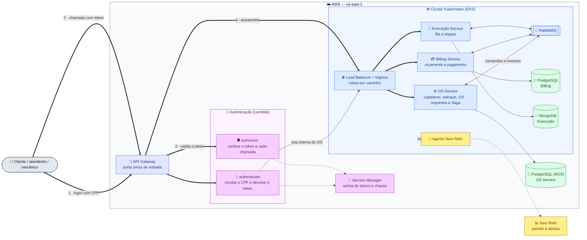

# Diagrama de componentes

Visão geral da Fase 4 na AWS. Leia o **caminho da requisição pelos números
(1 → 4)**. As setas pontilhadas são apoio: segredos e monitoramento.

**Legenda:** ⬜ usuários · 🟦 aplicação e mensageria · 🟪 autenticação e segredos · 🟩 bancos · 🟨 monitoramento

## Quem faz o quê

| Componente | Função | Repositório |
|---|---|---|
| API Gateway | Entrada única; limita a taxa de chamadas | `oficina-auth-lambda` |
| Lambda `authenticate` | Valida o CPF, consulta o cliente na rota interna do OS e gera o token (JWT) | `oficina-auth-lambda` |
| Lambda `authorizer` | Bloqueia chamadas sem token válido antes de chegarem ao cluster | `oficina-auth-lambda` |
| OS Service | Cadastros, estoque, OS e histórico; orquestra a Saga | `oficina_mecanica` |
| Billing Service | Orçamento, aprovação, cobrança e estorno | `oficina-billing-service` |
| Execução Service | Fila por filial e etapas da execução | `oficina-execucao-service` |
| RabbitMQ | Comandos e eventos entre os serviços, com retentativa e DLQ | `oficina-infra-k8s` |
| PostgreSQL do Billing | Banco exclusivo do Billing, dentro do cluster | `oficina-billing-service` |
| MongoDB | Banco exclusivo da Execução | `oficina-infra-k8s` |
| EKS + Ingress | Roda os serviços e ajusta o número de pods | `oficina-infra-k8s` |
| Agente New Relic | Envia logs e métricas para os painéis | `oficina-infra-k8s` |
| RDS PostgreSQL | Banco exclusivo do OS Service | `oficina-infra-db` |
| Secrets Manager | Senha do banco, chave do token e token interno | `oficina-infra-db` |

Nenhum serviço acessa o banco de outro: o que um serviço precisa do outro
chega no payload das mensagens ([contrato](../fase4/contrato-mensagens.md)).

## Por que o token é conferido duas vezes

1. **No Gateway**, para barrar chamadas inválidas antes de gastar recursos do
   cluster.
2. **Nos serviços**, porque o cluster também pode ser acessado sem passar pelo
   Gateway (por dentro da rede ou rodando local no kind).

Detalhes no [ADR-001](../adrs/ADR-001-api-gateway-lambda-authorizer.md).
