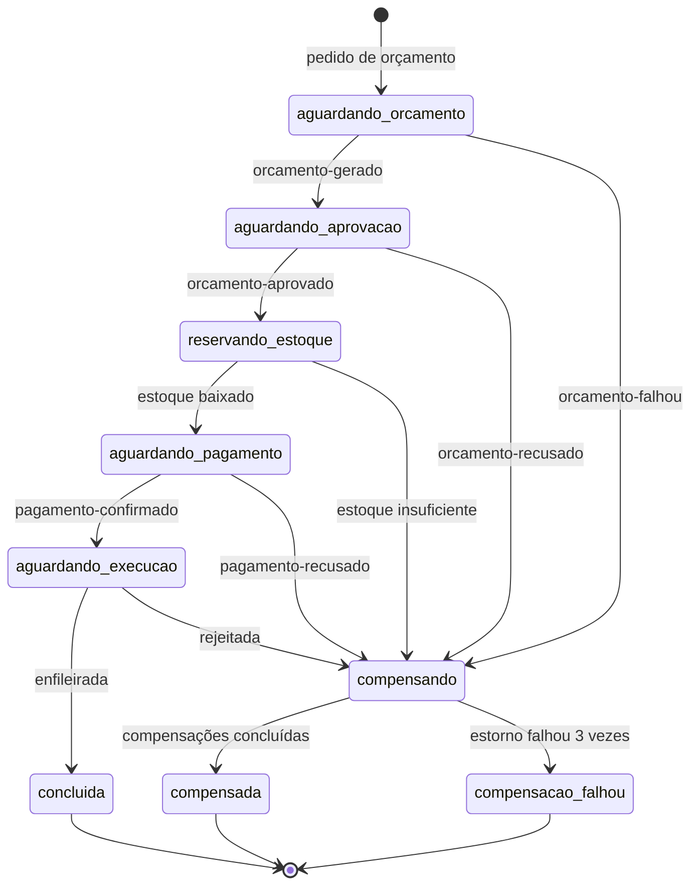
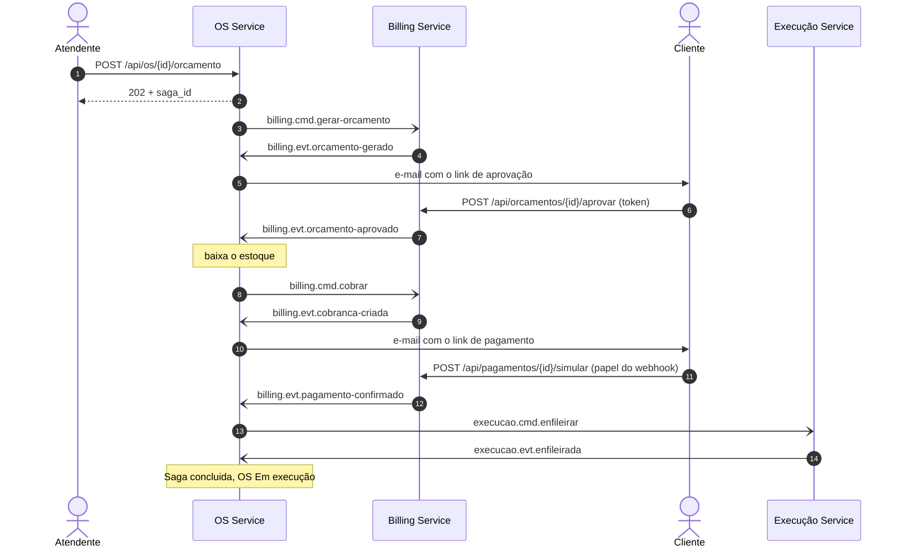
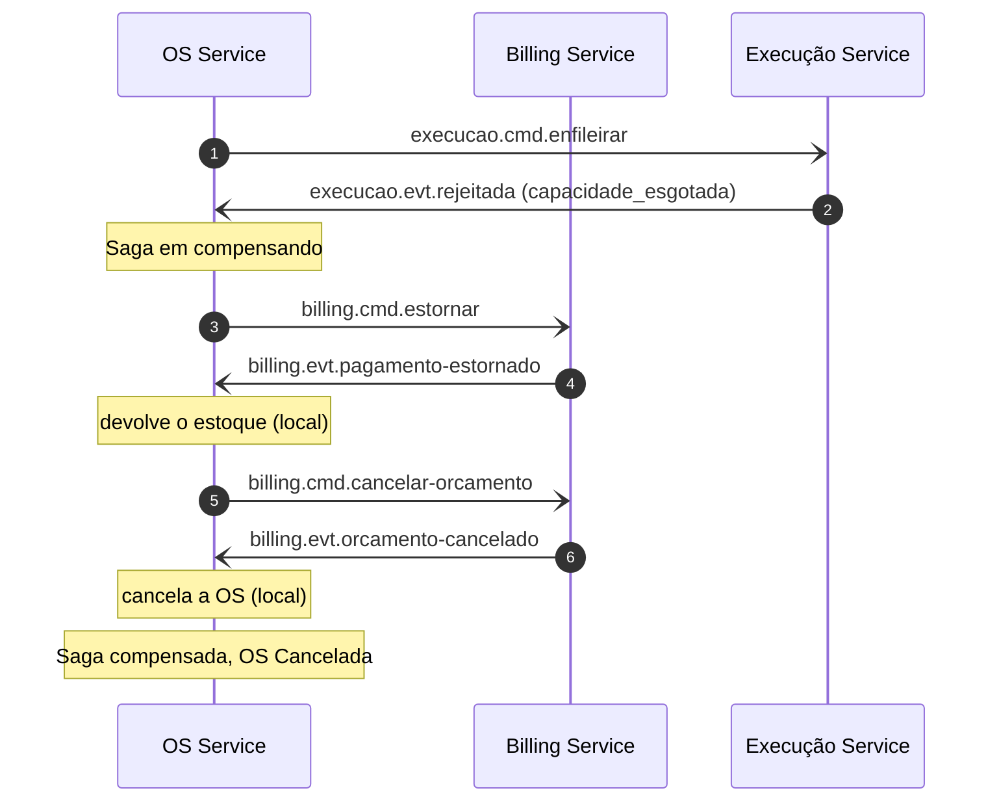

# Saga da OS

A Saga é orquestrada pelo OS Service (`OrquestradorSagaOS`), e a máquina de
estados fica na entidade `SagaOS`. Ela começa em `POST /api/os/{id}/orcamento`
(resposta **202** com o `saga_id`) e pode ser acompanhada em
`GET /api/os/{id}/saga`. Os comandos e eventos estão descritos em
[contrato-mensagens.md](../fase4/contrato-mensagens.md), e a escolha pela
orquestração em [ADR-006](../adrs/ADR-006-saga-orquestrada.md).

## Máquina de estados

- `reservando_estoque` é passageiro: a baixa do estoque acontece no mesmo
  tratamento do `orcamento-aprovado`. Se der certo, o OS envia `billing.cmd.cobrar`.
- `cobranca-criada` não muda o estado: guarda o link de pagamento e o envia ao
  cliente por e-mail.
- Depois de `concluida`, os eventos `status-alterado` e `finalizada` da Execução
  só atualizam o status da OS. Não há o que compensar: o carro já está na
  oficina.
- Evento que não cabe no estado atual é ignorado com log `warning`
  (`saga.evento_fora_de_ordem`).

| Estado da Saga | Status da OS |
|---|---|
| `aguardando_orcamento` | Em diagnóstico |
| `aguardando_aprovacao` | Aguardando aprovação |
| `reservando_estoque`, `aguardando_pagamento` | Aguardando pagamento |
| `aguardando_execucao`, `concluida` | Em execução |
| `compensando`, `compensacao_falhou` | mantém o status atual |
| `compensada` | Cancelada |

## Caminho feliz

As setas `-)` são mensagens no RabbitMQ (exchange `oficina`): comandos vão para
`billing.comandos` ou `execucao.comandos`, eventos para `os.saga.eventos`.

## Compensação: fila cheia na filial

O pior caso: a Execução rejeita a OS depois do pagamento, porque a filial
atingiu a capacidade (`EXECUCAO_CAPACIDADE_POR_FILIAL`). Tudo o que foi feito é
desfeito em ordem reversa.

As compensações remotas esperam a confirmação do Billing antes de seguir. As
locais (devolver estoque, cancelar a OS) rodam na hora.

## Falhas e compensações

| Falha | Evento | Estado em que ocorre | Compensações, em ordem |
|---|---|---|---|
| Orçamento não gerado | `billing.evt.orcamento-falhou` | `aguardando_orcamento` | cancelar OS |
| Cliente recusou | `billing.evt.orcamento-recusado` | `aguardando_aprovacao` | cancelar OS (o orçamento já fica recusado no Billing) |
| Estoque insuficiente | (local, na aprovação) | `reservando_estoque` | `cancelar-orcamento`, cancelar OS |
| Pagamento recusado | `billing.evt.pagamento-recusado` | `aguardando_pagamento` | devolver estoque, `cancelar-orcamento`, cancelar OS |
| Fila cheia na filial | `execucao.evt.rejeitada` | `aguardando_execucao` | `estornar`, devolver estoque, `cancelar-orcamento`, cancelar OS |

A lista é montada em `SagaOS::falhar()` a partir do que já foi feito. Não há
`execucao.cmd.cancelar` na compensação: quando a Execução rejeita, nada foi
criado na fila.

**Compensação que falha.** Se o Billing responder `billing.evt.estorno-falhou`,
o OS reenvia o `estornar`. Na 3ª falha, a Saga vai para `compensacao_falhou`,
com log `error` (`saga.compensacao_falhou`) para ação manual. Depois de
resolver a causa, `php artisan saga:reenviar {saga_id}` recoloca o último
comando na outbox; o destino é idempotente.

Os cenários desta tabela estão em `features/saga_os.feature` (Behat).
