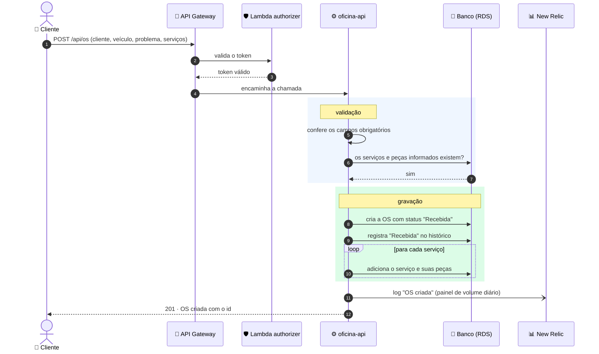

# Abertura de ordem de serviço

## Fluxo da requisição

Se algum serviço ou peça não existir, a API responde com erro **antes** de
gravar, para não sobrar OS pela metade.

## Ciclo de vida da OS

Depois da abertura, quem muda o status é a **Saga** ([saga.md](saga.md)). A
troca manual (`PATCH /api/os/{id}/status`) fica bloqueada com **409** enquanto
a Saga da OS estiver ativa.

```mermaid
stateDiagram-v2
    direction LR
    [*] --> Recebida
    Recebida --> EmDiagnostico: orçamento solicitado (Saga começa)
    EmDiagnostico --> AguardandoAprovacao: Billing gerou o orçamento
    AguardandoAprovacao --> AguardandoPagamento: cliente aprova · estoque baixado
    AguardandoPagamento --> EmExecucao: pagamento confirmado
    EmExecucao --> Finalizada: Execução finaliza
    Finalizada --> Entregue: cliente retira o carro
    Entregue --> [*]
    AguardandoAprovacao --> Cancelada: recusa
    AguardandoPagamento --> Cancelada: pagamento recusado (compensação)

    EmDiagnostico: Em diagnóstico
    AguardandoAprovacao: Aguardando aprovação
    AguardandoPagamento: Aguardando pagamento
    EmExecucao: Em execução

    classDef inicio fill:#e0e7ff,stroke:#4f46e5,color:#312e81
    classDef espera fill:#fef08a,stroke:#a16207,color:#713f12
    classDef trabalho fill:#dbeafe,stroke:#2563eb,color:#1e3a8a
    classDef fim fill:#dcfce7,stroke:#15803d,color:#14532d
    classDef erro fill:#fee2e2,stroke:#b91c1c,color:#7f1d1d
    class Recebida inicio
    class AguardandoAprovacao,AguardandoPagamento espera
    class EmDiagnostico,EmExecucao trabalho
    class Finalizada,Entregue fim
    class Cancelada erro
```

- **Cada mudança de status** fica registrada na tabela `os_status` com a data.
  A diferença entre dois registros é o tempo gasto em cada etapa, usado no painel
  "tempo médio por status".
- **Aprovar o orçamento** (no Billing) faz a Saga baixar o estoque das peças.
  Se o pagamento for recusado, a Saga devolve o estoque, cancela o orçamento e
  cancela a OS.
- **Finalizada** chega pelo evento `execucao.evt.finalizada` do Execução
  Service. **Entregue** continua sendo marcado à mão, depois da Saga.
- **Mudanças de status** disparam um e-mail ao cliente e uma métrica no New
  Relic, em partes separadas do código: se o e-mail falhar, a métrica continua
  sendo registrada.
